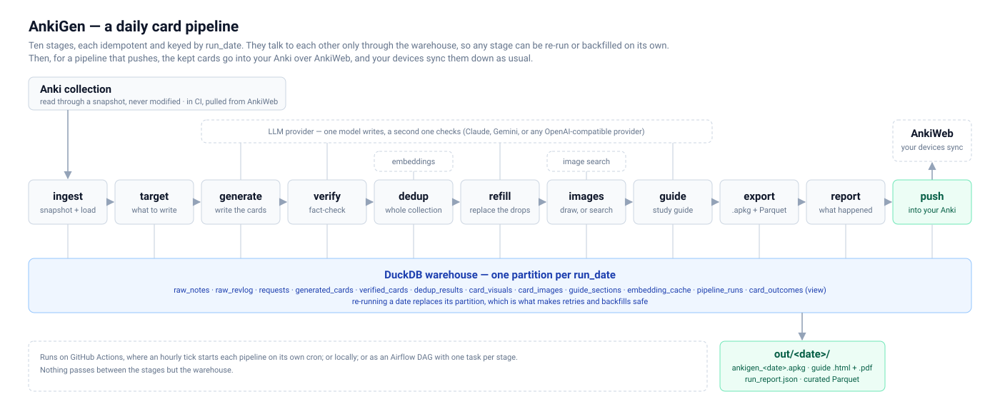

<p align="center">
  
</p>

<h1 align="center">AnkiGen</h1>

<p align="center">
  A daily LLM pipeline that writes Anki cards that fit the deck you already study.
</p>

<p align="center">
  <a href="https://github.com/PedroLFerraz/ankigen/actions/workflows/tests.yml"></a>
  <a href="https://github.com/PedroLFerraz/ankigen/actions/workflows/tick.yml"></a>
  <a href="https://github.com/PedroLFerraz/ankigen/actions/workflows/docker.yml"></a>
  
  <a href="LICENSE"></a>
</p>


A daily batch pipeline that reads your Anki collection and writes new cards
that fit it. The cards match the phrasing of cards you already study, avoid what
you already know, re-teach what you keep forgetting, and are fact-checked before
they reach you. You steer it with one YAML profile.

<p align="center">
  
</p>

<p align="center"><sub>Three cards from one day's run, as Anki shows their answers: a command broken into its parts, a diagram drawn from the card's own answer, and a comparison table.</sub></p>

It is also built the way a data platform team would build it: idempotent stages
keyed by date, a layered DuckDB warehouse, and output as Parquet. That makes it
ready to schedule with Airflow, containerise, and move to S3 and Kubernetes. See
the [roadmap](#roadmap).

<p align="center">
  
</p>

## Quick start

```bash
pip install ".[guide]"             # installs the `ankigen` command (+ the PDF guide)
cp .env.example .env               # set LLM_PROVIDER / LLM_API_KEY (Groq is free)
ankigen decks                      # see your decks, to write the profile
ankigen validate                   # check the profile against them
ankigen plan                       # what today's run would generate + the exact prompt
ankigen run                        # do it
ankigen report                     # what was kept, dropped, and why
```

Import `data/out/<date>/ankigen_<date>.apkg` into Anki with File > Import, and
read `data/out/<date>/guide_<date>.pdf` alongside it: it explains each card in
depth, and each card names its section.
Cards land **straight in their deck**, tagged `ankigen::run_<date>` so a batch
can be found or deleted later. Anything close to a card you already have is
tagged `ankigen::near-dup` with what it resembles, so search that tag first and
delete the few that are redundant. Re-importing the same day's package updates
those notes instead of duplicating them. (Set `inbox:` in the profile to file
them in a subdeck instead.)

## Documentation

[docs/README.md](docs/README.md) lists every part of the project, with a
page for each: the [CLI](docs/components/cli.md), the
[daily pipeline](docs/components/daily-pipeline.md) and its
[warehouse](docs/components/warehouse.md),
[LLM providers](docs/components/llm-providers.md),
[profiles and pipelines](docs/components/profiles-and-pipelines.md),
[card types and prompts](docs/components/card-types-and-prompts.md), the
[study guide](docs/components/study-guide.md),
[images](docs/components/images.md),
[AnkiWeb sync](docs/components/ankiweb-sync.md), and around the package,
[GitHub Actions](docs/components/github-actions.md), the
[Android app](docs/components/android-app.md),
[Airflow](docs/components/airflow.md) and
[Docker](docs/components/docker.md).
[docs/ARCHITECTURE.md](docs/ARCHITECTURE.md) explains how they fit together.

**Running it daily without leaving a machine on.** An hourly GitHub Actions
workflow runs each pipeline at its time, syncs your collection down from
AnkiWeb, writes the cards and syncs them back, so they appear on your phone
and desktop with nothing to import. Free on a public repo, with a few
secrets to set up: see [docs/GITHUB_ACTIONS.md](docs/GITHUB_ACTIONS.md).

**In Docker.** One image has everything a run uses, published to
`ghcr.io/pedrolferraz/ankigen`: see [Docker](docs/components/docker.md).

## Development

```bash
pip install -e ".[dev]"
python -m pytest
```

The tests build real SQLite collections in both Anki schemas and replace the LLM
and embedding provider with deterministic fakes, so they run offline in a few
seconds. Each component's page says which test files cover it.

## Roadmap

1. ✅ **Core pipeline**: personalised, verified, deduplicated, illustrated daily cards.
2. ✅ **Scheduled**: GitHub Actions daily; an Airflow DAG for local orchestration.
3. **Feedback loop**: the review history is already ingested — measure whether generated cards lapse more than hand-written ones, and whether illustrated cards stick better.
4. ✅ **Docker**: multi-stage image; the collection and profile mounted read-only.
5. **AWS free tier**: S3 `raw/`, `curated/` and `gold/` layers via Terraform, and a least-privilege IAM role.
6. **Kubernetes**: ✅ `CronJob` on `kind` ([infra/k8s](infra/k8s/README.md)), then `KubernetesPodOperator` per stage.
7. **Android client**: create, schedule and watch pipelines from a phone, with each run's study guide saved to a folder on it. The backend it drives (pipelines, the hourly tick, the status branch) is in place.
8. Later: PDF ingestion as a second source.

## License

MIT. See [LICENSE](LICENSE).
