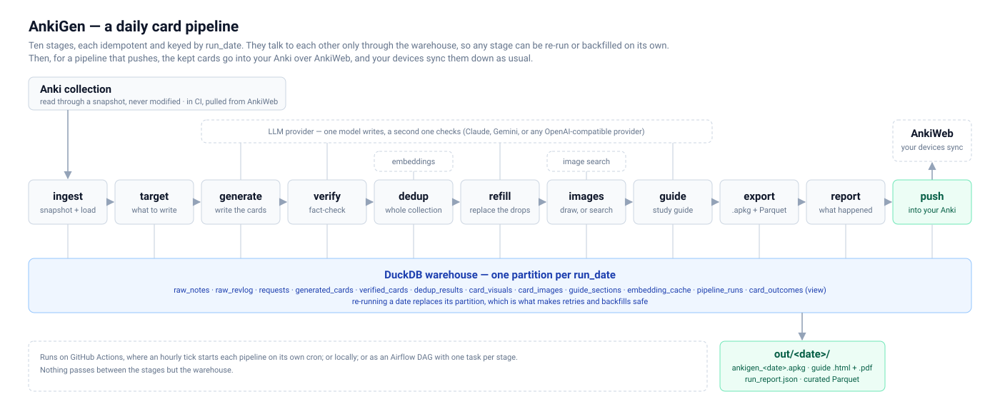

# AnkiGen architecture

This document explains how AnkiGen is built, the way a computer architecture
course would. It goes through the **abstraction levels** first, where each layer
only talks to the one directly below it. Then it covers the **pipeline**: the
steps every daily run goes through, with the tools used in each. Last come the
commands outside the daily run, and the loop of workflows that runs it.

> The analogy has limits: no instructions are executed here. It is useful
> because the same design problems come up. You need clear boundaries between
> layers, buffers between stages, a cache, and the ability to replay a stage
> safely.

---

## 1. The big picture



<sub>Source: [`pipeline.svg`](pipeline.svg). Renders in browsers, GitHub and most Markdown viewers, in light and dark themes.</sub>

A run takes a **date** as input. It reads a *copy* of your Anki collection and
writes new cards for that date. Every stage writes its results into one
database, the warehouse. Stages never pass data to each other in memory, which
is what makes the design robust. After the stages, a pipeline that pushes
syncs the kept cards into your collection over AnkiWeb, so your devices get
them with their next sync and there is nothing to import.

The LLM and embedding boxes are whichever provider the pipeline names. The
writer and the checker are configured apart: Claude through the Claude Code
CLI, or any OpenAI-compatible provider. Embeddings come from Ollama,
OpenRouter, or fastembed in-process, which is what the CI runner uses.

---

## 2. Abstraction levels

In a computer, each level (transistors, gates, microarchitecture, ISA, operating
system, programs) hides the one below it. AnkiGen has six levels, from the
lowest up:

```
 L5  Interface         ankigen CLI (typer)            │ what you type
 L4  Orchestration     pipeline.py                    │ runs stages in order, records status
 L3  Stages            ingest target generate verify  │ one job each, idempotent
                       dedup refill images guide      │
                       export report                  │
 L2  Domain model      Note, Profile, GenerationRequest, Card
 L1  Services          warehouse · llm · embeddings · image search · graphviz · genanki · AnkiWeb sync
 L0  Physical storage  collection.anki2 · warehouse.duckdb · files on disk
```

| Level | Computer analogy | What it is in AnkiGen | Files | Tools |
|---|---|---|---|---|
| **L0 Storage** | Memory and disk | Your Anki collection (read only), the AnkiWeb working copy, the warehouse database, and the files a run produces | `data/` | SQLite, DuckDB file, filesystem |
| **L1 Services** | Device drivers | Thin wrappers that hide *how* to talk to each external system: the database, the LLM, the embedding model, image search, Graphviz, the `.apkg` writer and AnkiWeb | `warehouse.py`, `llm.py`, `dedup.Embedder`, `images.py`, `visuals.py`, `export.py`, `push.py` | `duckdb`, `pyarrow`, `openai` SDK, Claude Code CLI, `requests`, Pillow, `dot`, `genanki`, `anki` |
| **L2 Domain** | Instruction set (ISA) | The vocabulary every stage shares: a `Note` read from Anki, a `Profile`, a `GenerationRequest`, a generated `Card` | `ingest.Note`, `profile.py`, `targeting.GenerationRequest`, `generate.Card` | `dataclasses`, `pydantic` |
| **L3 Stages** | Pipeline stages | Ten functions, each doing one job: read its input from the warehouse, write its output back | `ingest.py` … `export.py`, listed in `STAGES` in `pipeline.py` | see §3 |
| **L4 Orchestration** | Control unit | Decides which stages run, in what order, and records success or failure for each | `pipeline.py` | plain Python, or the Airflow DAG in `infra/airflow/` |
| **L5 Interface** | Shell | Commands a human types, or a workflow runs | `cli.py` | `typer` |

**The rule that makes it work:** a stage (L3) never calls another stage. It only
uses services (L1) and domain types (L2). That is why the orchestrator (L4) can
be swapped out, from `ankigen run` to an Airflow DAG to Kubernetes pods, without
touching any stage. The one deliberate exception is refill, which puts its
replacement cards through generate's, verify's and dedup's functions; it still
reads and writes only the warehouse, so it runs as one task like the rest.

---

## 3. The pipeline of events

### 3.1 CPU pipeline analogy

A classic CPU runs every instruction through the same stages. AnkiGen runs every
day through its own:

| CPU stage | What it does in a CPU | AnkiGen stage | What it does here |
|---|---|---|---|
| **IF**: Instruction Fetch | Read the next instruction from memory | **ingest** | Read the Anki collection into the warehouse |
| **ID**: Instruction Decode | Work out what the instruction means | **target** | Work out what to generate today, and build the prompts |
| **EX**: Execute | The ALU does the work | **generate** | The LLM writes the cards |
| hazard and fault checks | Detect bad results before committing | **verify** + **dedup** | Drop wrong cards and repeated cards |
| replay | Re-issue what a fault squashed | **refill** | Ask again for exactly the cards that were dropped |
| **MEM**: Memory access | Fetch operands from outside the core | **images** | Draw the card's own picture, or fetch one from the web |
| **WB**: Write Back | Commit the result | **guide** + **export** | Write the study guide and the `.apkg` |
| performance counters | Count what happened | **report** | Timings, drops, token use |
| write-back to shared memory | Make the result visible to other cores | **push** | Sync the cards to AnkiWeb, where your devices see them |

Two more pieces of hardware have direct equivalents:

- **Pipeline registers → warehouse tables.** In a CPU, a register sits between
  each pair of stages and holds the hand-off. Here, each stage writes to its own
  table (`requests`, `generated_cards`, `verified_cards`, …) and the next stage
  reads from it.
- **Cache → `embedding_cache`.** Converting text to an embedding is slow, like a
  memory access. The first run embedded 681 cards in 22s. The next run read them
  back from the cache in 0.8s.

The push keeps the coherence rule a shared cache line does: read the latest
copy before writing to it. It syncs down before it adds anything, so it never
writes over changes made on another device.

### 3.2 Stage by stage

```
 run_date ─▶ [ingest] ─▶ [target] ─▶ [generate] ─▶ [verify] ─▶ [dedup] ─▶ [refill] ────┐
              raw_notes   requests    generated_    verified_   dedup_     more rows   │
              raw_revlog              cards         cards       results    in those    │
                                                                           three       │
 ┌─────────────────────────────────────────────────────────────────────────────────────┘
 └─▶ [images] ─▶ [guide] ─▶ [export] ─▶ [report]   then   push ─▶ AnkiWeb
      card_visuals guide_    .apkg       run_report
      card_images  sections  parquet     .json
```

From verify on, each stage reads the `card_outcomes` view, which joins the
tables before it into one row per card. `ankigen run` runs all ten in this
order. A pipeline whose `pipeline.yaml` asks for no PDF leaves out the guide,
and `--stage` runs any one of them on its own.

#### ① ingest: fetch

| | |
|---|---|
| **Input** | `collection.anki2`: your live Anki file, or in CI the AnkiWeb working copy that `ankigen pull` brings up to date |
| **Output** | `raw_notes` (a full snapshot each day), `raw_revlog` (only new reviews) |
| **Tools** | `sqlite3` **backup API**, `html` (strip tags), `re` (strip cloze markers), `pyarrow` → DuckDB |

1. Take a consistent **snapshot** into `raw/<date>/collection.anki2`. It
   uses the backup API because Anki keeps recent changes in a separate `-wal`
   file that a plain copy misses. A test proves this.
2. Read the decks, turning Anki's `\x1f` separator into `::`. Read note types in
   both the old and new schema.
3. For every note, find the **front and back** without knowing its note type:
   take the first two fields that still contain text once images and audio are
   removed. This handles `Front/Back`, `Frente/Verso`, `Vorderseite/Rückseite`
   and so on.
4. Attach review stats to each note: lapses, ease, interval.
5. Load **notes** as a full daily snapshot. Load **reviews** *incrementally*:
   only rows with an id newer than the ones already loaded. These are the two
   classic loading patterns.

#### ② target: decode

| | |
|---|---|
| **Input** | `raw_notes`, the pipeline's `profile.yaml` |
| **Output** | `requests`: one row per request, including the complete prompt |
| **Tools** | `pydantic` + `PyYAML` (profile), `random` seeded by the date, `string.Template` + `importlib.resources` (prompt files) |

For each deck in the profile, up to its `daily_quota`:

1. **Weak cards first.** These are cards with 2 or more lapses, or ease at or
   below 2100. It shuffles the 12 weakest and asks for the fact to be taught
   from a *different angle*, not reworded.
2. **Topics next.** It rotates through the profile's topics by date, about 5
   cards per topic. A deck with a `start:` date is a curriculum step instead:
   nothing before that day, then its topics once, in order from the first,
   `daily_quota / 5` a day, then nothing, weak cards included. Decks with
   start dates run one after another; `ankigen validate` prints the timeline
   and fails if two running at once want more than `global_quota`. Those
   dates are the curriculum's days, not the calendar's: a plan run with no
   date writes the day after the latest `ankigen::run_<date>` tag in the
   collection (`ankigen next`), so extra runs move the curriculum ahead and
   the schedule carries on from there. Cards for one deck by hand are tagged
   `ankigen::ad-hoc` as well and do not count.
3. **No topics?** It asks the model to find what the deck is missing.

Each prompt is built from the `prompts/generate.txt` template and contains:

- the learner profile and style rules
- **few-shot examples**: real cards from your deck, so new cards match your
  phrasing and length
- a **do-not-duplicate list**: the 40 existing cards most related to today's
  topic. Unrelated cards are left out to save tokens.
- the JSON format the answer must follow

This stage is **deterministic**: the same date always produces the same plan.
It makes no network calls, which is why `ankigen plan` is instant.

#### ③ generate: execute

| | |
|---|---|
| **Input** | `requests` |
| **Output** | `generated_cards` (with token counts, and the picture each card asks for: an image query, or a table or diagram described as `visual_json`) |
| **Tools** | the writer the pipeline names: **Claude** through the Claude Code CLI on the subscription, or the `openai` SDK for any OpenAI-compatible provider (Groq, OpenRouter, NVIDIA, Mistral, SambaNova, Ollama) |

1. Send the prompt and ask for JSON. If a model refuses JSON mode, switch
   to reading the JSON out of plain text, and remember that for the model.
2. On a rate-limit error, wait as long as the provider says ("try again in 7s"),
   up to 3 attempts. A model whose daily allowance is spent hands over to the
   next one in the pipeline's list.
3. Parse and clean each card, and repair broken cloze syntax.
4. If fewer cards came back than asked for, ask **once** more for the rest.
5. If one request fails, the others carry on.

**This stage and refill are the only ones whose output changes from run to
run.** Every later stage reads what they stored, so retrying any later stage
never calls the writer again.

#### ④ verify: fault check

| | |
|---|---|
| **Input** | `generated_cards` |
| **Output** | `verified_cards` (passed, score, reason, and whether a described table or diagram is right) |
| **Tools** | the checker's provider, with the `prompts/verify.txt` fact-checker prompt |

One call per request checks all of its cards. A card **passes** only if it is
*correct*, *answerable*, and scores at least 0.7. A table or diagram the
checker finds wrong is not drawn; the card keeps its text.

If the checker itself fails (outage, rate limit or its usage limit reached),
the stage fails: a card nobody checked is not passed on. The next run writes
the day again, and nothing is pushed in between.

#### ⑤ dedup: hazard check

| | |
|---|---|
| **Input** | cards that passed verify; `raw_notes`; cards kept by earlier runs |
| **Output** | `dedup_results` (is it a duplicate, why, how similar) |
| **Tools** | `difflib` (fuzzy match), an embedding provider (**Ollama** `nomic-embed-text` locally, **OpenRouter** `liquid/lfm-2.5-embedding-350m:free`, or **fastembed** `BAAI/bge-small-en-v1.5` in-process), `numpy` (vectorised cosine), `embedding_cache` |

Two checks. The cheapest one runs first:

1. **Fuzzy**: question wording at least 0.85 similar → duplicate.
2. **Semantic**: embedding cosine similarity at least 0.90 → duplicate. This
   catches rewordings the fuzzy check misses.

Each card is compared with its deck and subdecks, with cards kept by earlier
runs that you haven't imported yet, and with cards already kept in this run.
Only decks the profile targets are embedded, so a 5,000-card German deck costs
nothing. If embeddings are unavailable, only the fuzzy check runs, and the
report says so.

#### ⑥ refill: replay

| | |
|---|---|
| **Input** | `card_outcomes` (what each request kept and dropped, and why), `requests` |
| **Output** | new rows in `generated_cards`, flagged `refill`, with their `verified_cards` and `dedup_results` rows |
| **Tools** | the writer and the checker again; `re` to rewrite the request's own prompt; verify's and dedup's functions, run on the new cards only |

A request asks for N cards, and every card verify or dedup drops leaves the
day that much short. Refill asks again for exactly the missing number:

1. Find the requests that kept fewer cards than they asked for. A request that
   produced nothing at all is skipped: asking again would fail the same way.
2. Rewrite its prompt to ask for the difference, and add what the first attempt
   produced: the kept cards, not to repeat, and the rejected ones with the
   reason each was rejected.
3. Put the new cards through the same verify and dedup as the rest of the day.

**One round only.** A topic that keeps failing should not spend the day's
allowance on it, and a second round would mostly repeat the first. If the
allowance runs out mid-stage, refill stops and the day keeps what it has.

It needs verify and dedup to have run, and stops with an error if any card is
still `pending`. A rerun first deletes every row flagged `refill` for the date,
with their verify and dedup rows, so it stays idempotent.

#### ⑦ images: memory access

| | |
|---|---|
| **Input** | `card_outcomes` filtered to `outcome = 'kept'`, for cards that described a picture or asked for one; the profile, for which decks want pictures and what to search them with |
| **Output** | `card_visuals` (drawn tables and diagrams, as HTML); `card_images` (pictures found on the web); the files in `media/` |
| **Tools** | Graphviz `dot` (diagrams to SVG), `requests` (DuckDuckGo image search), Pillow (JPEG, at most 800px wide), the checker's vision model (`llm.check_image`), a `ThreadPoolExecutor` of 3 |

It runs after dedup, so no picture is ever fetched for a card about to be
thrown away.

1. **Draw first.** A card whose writer described a table or a diagram
   (`visual_json`) gets that drawn: a table as an HTML table, a diagram through
   `dot` as inline SVG. Text and lines are `currentColor`, so one drawing reads
   on dark and light cards. A diagram that uses attributes able to read files
   or emit links, or that is too large, is not drawn. Neither is one verify
   found wrong. A drawn card is not searched for: the drawing is of exactly
   what the card says.
2. **Search for the rest.** A card that asked for a real picture is searched
   for with its query and the deck's image context. Results are filtered by
   their titles first, then the checker's model **looks at** each candidate
   and keeps the first one that illustrates the card (unless the profile sets
   `verify_images: false`). Looks are capped: 3 per card and 24 per run,
   since each is a request on a metered allowance.
3. **No look, no picture.** When the checker is down or its allowance is spent,
   the card goes without one. A card with no picture beats a card with the
   wrong one.

Everything found is saved as JPEG, which Anki imports reliably. A picture that
fails to download or check never fails the stage.

#### ⑧ guide: the explanations

| | |
|---|---|
| **Input** | `card_outcomes` view, filtered to `outcome = 'kept'`, with `requests` |
| **Output** | `guide_sections`; `out/<date>/guide_<date>.html` and `.pdf` |
| **Tools** | the writer's LLM (`prompts/guide.txt`), the checker's (`prompts/guide_check.txt`), `markdown`, WeasyPrint |

1. Number the chapters (one per request, decks in the profile's order, topics
   in the curriculum's) and the cards under them, **before** any model call,
   so each card's reference (`§2.3`) holds even if its chapter is not written.
2. Per chapter, one call writes an opening and a section per card, and one
   checker call reads it. A disputed section is kept and marked; one never
   checked is marked unchecked.
3. Render HTML, and a PDF when WeasyPrint is installed.

Runs after images so drawn tables and diagrams appear in it, and before export
so the notes carry their reference. Like verify, it never fails the run: a
spent allowance leaves the rest of the guide "not written today".

#### ⑨ export: write back

| | |
|---|---|
| **Input** | `card_outcomes` view, filtered to `outcome = 'kept'`; the pictures in `media/` |
| **Output** | `out/<date>/ankigen_<date>.apkg`; `curated/<table>/run_date=<date>/part-0.parquet` |
| **Tools** | `genanki`, DuckDB `COPY … TO … (FORMAT PARQUET)` |

- New notes go **straight into their target deck**, or into a subdeck under
  it (`<deck>::<inbox>`) when the profile sets `inbox:`. They are tagged
  `ankigen`, `ankigen::run_<date>`, `ankigen::<reason>` and
  `ankigen::pipeline::<id>`, so a day or a whole pipeline can be found later.
- A note's **GUID comes from the card's id**. Importing the same day twice
  updates those notes instead of duplicating them.
- It uses the same note-type IDs your collection already has, so no duplicate
  note types are created.
- If a rerun keeps nothing, the old `.apkg` is deleted rather than left behind.

#### ⑩ report: performance counters

| | |
|---|---|
| **Input** | `pipeline_runs` + `card_outcomes` |
| **Output** | `run_report.json` (read it with `ankigen report`, or `ankigen summary` for Markdown) |
| **Tools** | DuckDB SQL, `json` |

This is a separate last stage, so every earlier stage has finished when the
report is written. It shows per-stage timings, outcomes per deck, every dropped
card with its reason, and token use.

#### then: push to AnkiWeb

| | |
|---|---|
| **Input** | `card_outcomes` filtered to `outcome = 'kept'` for the date; the pictures in `media/`; the AnkiWeb working copy `data/anki/collection.anki2` |
| **Output** | new notes in your collection on AnkiWeb, and the pictures of notes already there brought up to date |
| **Tools** | the official `anki` package (its sync protocol), `genanki.guid_for`, `ANKIWEB_KEY` from `ankigen push --login` |

Not a stage: `ankigen push` runs after `ankigen run`, and in CI only for a
pipeline whose `pipeline.yaml` has `push_to_ankiweb` on. A pipeline that does
not push leaves its cards in the run's `.apkg`. AnkiWeb has no API for adding
notes. It has the sync protocol, so the push keeps a collection of its own,
adds notes to it and syncs it up:

1. **Sync down**, so this copy is never behind yours. If AnkiWeb asks for a
   one-way sync instead, it stops: settling that means picking which side wins,
   and picking ours could overwrite years of review history. The only full
   sync it ever does is the first download, when there is no copy yet.
2. **Add** each card the collection does not have, into the same deck the
   `.apkg` would use, with the same tags. The GUID is the one
   export uses, so a card pushed and a card imported are the same note. A note
   already there is left alone except for the picture this program put on it,
   so rerunning images and pushing again repairs a day's pictures without
   touching your edits.
3. **Sync up.** Your devices then sync down as usual and the cards are there.

Pictures travel inside the note as `data:` URIs, and media is never synced
from here: for this working copy, media sync would mean downloading the whole
of your media folder on every run.

---

## 4. The warehouse, as a memory map

One DuckDB file per pipeline, `data/pipelines/<id>/warehouse.duckdb`, split
into layers:

| Layer | Table / view | Written by | Load pattern |
|---|---|---|---|
| raw | `raw_notes` | ingest | full snapshot per date |
| raw | `raw_revlog` | ingest | incremental, by review id |
| plan | `requests` | target | replaces that date's rows |
| stage | `generated_cards` | generate, refill | generate replaces that date's rows; refill replaces only its own, flagged `refill` |
| stage | `verified_cards` | verify, refill | the same, per card |
| stage | `dedup_results` | dedup, refill | the same, per card |
| stage | `card_visuals` | images | replaces that date's rows: the table or diagram drawn for a card, as HTML |
| stage | `card_images` | images | replaces that date's rows: the picture found for a card, or why there is none |
| stage | `guide_sections` | guide | replaces that date's rows |
| mart | `card_outcomes` *(view)* | derived | joins the above, one row per generated card: `kept` / `dropped_verify` / `dropped_duplicate` / `pending` |
| cache | `embedding_cache` | dedup | keyed by (content hash, model) |
| ops | `pipeline_runs` | orchestrator | one row per (date, stage): status, rows, timing, detail |

**The idempotency guarantee.** In one transaction, a stage deletes that date's
rows and inserts the new ones (`Warehouse.replace_partition`). Running a stage
twice leaves one copy of the data, never two. That is what makes retries and
backfills safe, the way a CPU can re-execute an instruction after an exception
without leaving a side effect behind.

Inserts go through **Arrow**, not `executemany`. `executemany` costs about
0.6 ms per row, so the 142k-row review history took minutes. Arrow loads it in
under a second.

Files on disk:

```
data/
  anki/collection.anki2                  the AnkiWeb working copy, shared by every pipeline
  pipelines/<id>/
    warehouse.duckdb                     all tables above
    raw/<date>/collection.anki2          that day's snapshot
    media/                               pictures found by the images stage
    out/<date>/ankigen_<date>.apkg       import into Anki
    out/<date>/guide_<date>.html, .pdf   the study guide
    out/<date>/run_report.json           what happened
    curated/<table>/run_date=<date>/     Parquet, laid out the way S3 will be
    books/<book>/chNN.json, .apkg        ankigen book (§6)
```

A run with no pipeline named, from a bare profile, keeps the same layout
directly under `data/`.

---

## 5. Control signals: failure behaviour

| Where it fails | What happens | Why |
|---|---|---|
| Anki is open (collection locked) | ingest retries 3 times, then asks you to close Anki | Anki holds the file exclusively |
| Profile names a deck that doesn't exist | target stops before any LLM call | fail early and cheaply |
| A provider cannot work at all | the run stops before ingest, in a second | say so once, not once per request |
| One generation request errors | the stage fails and writes nothing; the next run writes the whole day | a day that ran short is not a finished one |
| Rate limited | wait as long as the provider says, then retry | respect the free tier |
| A model's daily allowance is spent | the next model in the pipeline's list takes over | the day still gets written |
| Model refuses JSON mode | read JSON from plain text and remember it | providers differ |
| Fact-checker unavailable | the stage fails; nothing is pushed | no card goes to Anki unchecked |
| Embeddings unavailable | fuzzy check only; the report says so | degrade, don't crash |
| Refill's allowance runs out | refill stops; the day keeps what it has | the drops are a shortfall, not a failure |
| A picture can't be checked | the card goes without one | no picture beats the wrong one |
| AnkiWeb asks for a one-way sync | the push stops and says so | only you should choose which side wins |
| Any stage raises | `pipeline_runs.status = 'failed'`, error saved | visible, and can be retried |
| A scheduled run fails | the tick tries it again on the next hours, 3 times in all | a passing outage shouldn't cost the day |

---

## 6. Outside the daily run

Three commands do work the daily run doesn't. None of them is a stage, and
none writes to the warehouse; each reuses the services and functions the
stages use.

### `ankigen book`: cards from a book

| | |
|---|---|
| **Reads** | a PDF on this machine, split by its chapter bookmarks |
| **Writes** | `books/<book>/chNN.json` (the cards, for review), `chNN.apkg`, and the book's figures as PNGs; with `--push`, the cards in Anki |
| **Reuses** | `llm.call_json`, generate's field cleaning, export's `build_package` and tags, the push's sync down, add, sync up |

Cards written from a topic name assume whatever background the model thinks
is usual. Written from the book being read, each one leans on what the book
has explained so far, cites its page, and carries the book's own figure when
one shows the idea. One model call per section, in the book's order, and the
chapter goes to its own subdeck (`<Book>::01 Chapter title`). Once a chapter's
cards are written they are reused as they are, so the ones you reviewed in the
`.json` are the ones `--push` sends; `--rewrite` asks for new ones. There is
no verify or dedup: the book is the source. The PDF never leaves the machine
and never enters the repository.

### `ankigen add-theme`: start a subject

| | |
|---|---|
| **Reads** | the profile, and a deck name with a sentence on what it should cover |
| **Writes** | a new deck appended to `profile.yaml` as text, so the file's comments survive; with `--summary`, Markdown for a pull request |
| **Reuses** | `llm.call_json` with `prompts/theme.txt`; the `Profile` model, which validates the result before anything is written |

Writing a deck's topic list is the slow part of starting a subject, and the
part that decides what it teaches for weeks. One request drafts it, in the
order the subject is taught and the shape of the decks already there. In a
profile with a curriculum, the new deck starts the day after the last one
ends, and `global_quota` is raised if the new deck would otherwise get no
cards. From CI (`add-theme.yml`, §7) it arrives as a pull request, so nothing
joins the daily run until it is merged.

### `ankigen parts`: explain old command cards

| | |
|---|---|
| **Reads** | your collection, through the AnkiWeb working copy |
| **Writes** | a breakdown of what each piece of the command does, appended under the answer of command notes that lack one; then syncs up |
| **Reuses** | the push's sync down and sync up, generate's breakdown rendering, the writer (`prompts/parts.txt`) and the checker (`prompts/parts_check.txt`) |

New command cards are written with a breakdown. This gives the older ones the
same, and plain cards whose whole answer is one command too. It appends to an
existing field rather than adding one, because a new field changes the note
type, which Anki can only sync one way. A breakdown the checker faults, or
could not check, is left off, and the next run asks again. `--dry-run` shows
them and changes nothing.

Two smaller commands also work on the collection: `ankigen audit-images` reads
it (never writes it) and names the pictures on older cards worth removing, and
`ankigen reset` deletes a pipeline's generated files but never touches the
collection.

---

## 7. Several pipelines, and the loop around them

Everything above is one **pipeline**: one profile, one warehouse, one
curriculum. A repository holds several, one folder each under `pipelines/`,
and a run is one of them, chosen with `ANKIGEN_PIPELINE`:

| | per pipeline | shared |
|---|---|---|
| what to teach | `pipelines/<id>/profile.yaml` | |
| how to run it | `pipelines/<id>/pipeline.yaml`: cron and time zone, outputs, models, budget | |
| storage | `data/pipelines/<id>/` (warehouse, snapshots, output) | `data/anki/`, the AnkiWeb working copy |
| curriculum | the days its own decks have cards for | |
| credentials | | the repository's secrets |

**The curriculum queue is per pipeline.** The next curriculum day is the day
after the last one the collection has cards for, and the collection is
shared, so only notes in the pipeline's own decks count; two pipelines may not
share a deck. A pipeline that never pushes counts the days in its warehouse
instead, since its cards never reach the collection.

### The outer loop

The repository is the backend. The Android app (`android/`) and GitHub's own
interface change what is planned by committing to it, a set of workflows turns
commits and schedules into runs, and every run reports back on the
`ankigen-status` branch, which both the tick and the app read:

```
 app: Setup ────────────── commit pipeline.yaml ───────────────┐
 app: Change the plan ──── edit-plan ─▶ plan/<id>/… ── Apply ──┤
 GitHub: add a theme ───── add-theme ─▶ pull request ── merge ─┤
                                                               ▼
                                                     pipelines/ on master ──▶ curriculum ──┐
                                                               │                           │
 tick (hourly) ──▶ pipelines due? ──┐                          │ every run reads it        │
 app: Run now ──────────────────────┴──────────▶ run-pipeline ◀┘                           │
                                                      │                                    │
                                                      ├──▶ AnkiWeb ──▶ your devices        │
                                                      ▼                                    │
                                               ankigen-status ◀────────────────────────────┘
                                               latest.json, runs/, cards/, curriculum.json
                                                      │
                                                      └──▶ the tick (what already ran) and the app (what happened)
```

**The scheduler is a tick.** GitHub's schedule is one cron per workflow file,
so `tick.yml` runs hourly, asks `ankigen pipelines due` which crons have fired
since each pipeline last ran, and runs those through `run-pipeline.yml`, one
after another: one AnkiWeb collection means one sync at a time. Times the tick
missed collapse into one run, and a failed one is tried again on the next
ticks. `pipelines.py` imports nothing heavy, so the tick decides what is due
after installing only pydantic and cronsim.

**A run, on GitHub's machines.** Each one gets a clean VM: `ankigen pull`
brings the AnkiWeb working copy up to date, `ankigen next` settles the day,
`ankigen run` runs the stages, and `ankigen push` syncs the cards up for a
pipeline that pushes. The warehouse and the working copy are kept in the
Actions cache between runs, and the `.apkg`, guide PDF and report are kept as
an artifact for 90 days. Last, even when the run failed, it records the
outcome on `ankigen-status`; a failure the tick never heard of would be
retried every hour.

**Every workflow, and what starts it:**

| Workflow | Started by | What it does |
|---|---|---|
| `tick.yml` | a schedule, hourly at minute 23; by hand, with a dry run | runs the pipelines whose cron has fired, one at a time |
| `run-pipeline.yml` | the tick (`workflow_call`); by hand, or the app's Run now (`workflow_dispatch`) | one run of one pipeline, as above; by hand it can also write one deck, on a topic, or redo some stages of a day |
| `edit-plan.yml` | the app's Change the plan and New pipeline (`workflow_dispatch`) | Claude Code edits `pipelines/<id>/` on a draft `plan/<id>/…` branch and checks it with `ankigen pipelines validate`; the app's Apply merges it, Discard deletes it |
| `add-theme.yml` | by hand, from GitHub's web or phone app (`workflow_dispatch`) | runs `ankigen add-theme` and opens a pull request with the new deck |
| `curriculum.yml` | a push to master that changes `pipelines/` | rewrites `curriculum.json` on `ankigen-status`, so a merged plan shows in the app at once rather than after the next run |
| `tests.yml` | every pull request, and every push to master | the tests, one job per component, then the whole pipeline end to end, in-process and through the installed command |
| `docker.yml` | pull requests and pushes to master that change the image | builds and scans the `Dockerfile` image; on master, pushes it to ghcr.io |
| `android.yml` | pull requests and pushes to master that change `android/` | the app's tests and a debug APK; on master, the APK replaces the one on the `app-latest` pre-release |

**The app** reads each pipeline's `pipeline.yaml` from master and its runs,
cards and curriculum from `ankigen-status`. It writes back in three ways: its
Setup screen commits `pipeline.yaml` directly, which CI validates; its plan
changes go through `edit-plan` drafts it merges or deletes; and Run now
dispatches `run-pipeline`. Study guide PDFs come from each run's artifact.
See [`android/README.md`](../android/README.md).

---

## 8. Tool map

| Tool | Used for | Stage(s) |
|---|---|---|
| `sqlite3` backup API | consistent snapshot, including the WAL | ingest |
| DuckDB | warehouse, SQL, Parquet export | all |
| PyArrow | fast bulk inserts | all writers |
| Pydantic + pydantic-settings | profile and pipeline validation, `.env` settings | target, config, the tick |
| PyYAML | read the profile and `pipeline.yaml` | target, the tick |
| `string.Template` + `importlib.resources` | prompt templates shipped inside the package | every stage that calls a model |
| Claude Code CLI | Claude as writer and checker, on the subscription; editing plans | generate, verify, refill, images, guide; `edit-plan` |
| `openai` SDK | any OpenAI-compatible provider, for both chat and embeddings | the same, and dedup |
| Ollama, OpenRouter or fastembed | embeddings for dedup | dedup, refill |
| NumPy | vectorised similarity | dedup |
| `difflib` | fuzzy wording match | dedup |
| `requests` + DuckDuckGo | image search | images |
| Pillow | pictures to JPEG, and inline copies for the push | images, push |
| Graphviz (`dot`) | diagrams to inline SVG | images |
| `markdown` + WeasyPrint | the study guide, as HTML and PDF | guide |
| genanki | writes `.apkg` packages | export, book |
| `anki` | the AnkiWeb sync protocol | push, pull, parts, book |
| `pypdf` | a book's text, bookmarks and figures | book |
| cronsim | reads each pipeline's cron in its own time zone | the tick |
| Typer | CLI | interface |
| pytest | offline tests with a fake LLM and fake embeddings, one CI job per component | — |

---

## 9. What the future phases swap out

Levels L0 to L3 stay the same. Later phases only replace orchestration (L4) and
where the data lives (L0):

| Phase | Replaces | With | Where it stands |
|---|---|---|---|
| 2 Docker | the Python environment you run it in | one image, with the collection mounted read-only and everything written to a `/data` volume | **done**: the `Dockerfile` (#56); `docker.yml` builds, scans and publishes it to ghcr.io (#57) |
| 3 Airflow | L4 `pipeline.run` | DAG `ankigen_daily`: one task per stage, `{{ ds }}` as `run_date`, `catchup` for backfills | **runs locally**: `infra/airflow/`, with Docker Compose |
| 4 AWS | L0 local files, and the runner | S3 `raw/`, `curated/`, `gold/`; DuckDB reads Parquet straight from S3; the run on ECS Fargate | **planned**: Terraform foundation (#59), deploys through OIDC (#60), Fargate on a schedule (#61), a cost per run and per card (#62), Bedrock as a provider (#63) |
| 5 Kubernetes | L4 again | a `CronJob` on kind, then Airflow's `KubernetesPodOperator`, one pod per stage | **planned**: #64, #65 |

Across all of them, stage metrics, a dashboard and an SLO alarm for the daily
run are planned in #66.

This is only possible because every stage already has the same contract:
`stage(context, run_date)` reads the warehouse and replaces its own partition.
